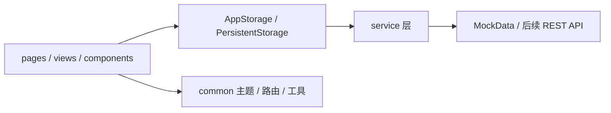

# 鸿蒙优选 · HarmonyOS 电子商城

> 《移动应用开发》课程大作业 · 四人团队项目  
> HarmonyOS NEXT / ArkTS / ArkUI / Stage 模型

鸿蒙优选是一个面向 HarmonyOS NEXT 的电子商城示例应用，覆盖 **商品浏览、购物车与下单、登录** 三项基础能力，并预留收藏、优惠券、订单状态、深色模式等自选功能。仓库当前处于 **框架搭建阶段**：工程结构、导航、数据模型、Mock 服务与核心页面骨架已经就位，业务细节按 Issue 分工推进。

## 功能规划

| 模块 | 功能 | 当前状态 |
| --- | --- | --- |
| 浏览 | 首页商品流（List + LazyForEach） | 已搭建，待真机验证 |
| 浏览 | 下拉刷新、上拉加载、到底提示 | 已搭建，待真机验证 |
| 浏览 | 多品类 Tab（精选/手机/电脑/穿戴/家居/配件） | 已搭建 |
| 浏览 | 分类页、搜索、商品详情 | 已搭建 |
| 购物 | 购物车增删改选、金额计算 | 已搭建 |
| 购物 | 订单确认、订单列表、收货地址 | 已搭建 |
| 登录 | 登录/退出、登录态保持 | 已搭建（Mock） |
| 用户 | 个人中心、收藏 | 已搭建 |
| 自选 | 优惠券、深色模式、评价 | 待开发 |

> “已搭建”表示代码骨架与 Mock 流程已完成，仍需在 DevEco Studio 中编译并在真机/模拟器上走查。

## 技术栈

- **系统**：HarmonyOS NEXT（Stage 模型）
- **语言**：ArkTS
- **UI**：ArkUI 声明式开发
- **构建**：DevEco Studio / Hvigor
- **兼容版本**：`compatibleSdkVersion: 5.0.0(12)`
- **数据**：本地 Mock 数据 + `AppStorage` / `PersistentStorage`

## 工程结构

```text
harmony-mall/
├── AppScope/                       # 应用级配置与图标
├── entry/src/main/
│   ├── module.json5                # 模块、Ability、权限
│   ├── ets/
│   │   ├── entryability/           # 应用入口与持久化初始化
│   │   ├── pages/                  # 8 个页面（Index/详情/搜索/登录/订单/收藏/地址）
│   │   ├── views/                  # 首页/分类/购物车/我的 四个 Tab 视图
│   │   ├── components/             # 商品卡、商品流、空状态、页面导航
│   │   ├── model/                  # Product / CartItem / Order
│   │   ├── data/MockData.ets       # 16 件商品 + 分类 + 轮播图
│   │   ├── service/                # 商品/购物车/订单/登录/收藏
│   │   ├── viewmodel/              # LazyForEach 数据源
│   │   └── common/                 # 常量、主题、路由、日志、Toast
│   └── resources/                  # 字符串、颜色、图标、页面清单
├── docs/                           # 需求、设计、规范、测试、提交文档
├── .github/                        # Issue / PR 模板与仓库检查
├── build-profile.json5
├── oh-package.json5
└── hvigorfile.ts
```

## 快速开始

1. 安装 **DevEco Studio 5.0.5 或更高版本**，并在 SDK Manager 中安装 **API 12**。
2. `File > Open` 打开本仓库根目录，等待 Hvigor Sync 完成。
3. 打开 `File > Project Structure > Signing Configs`，勾选 **Automatically generate signature**（仓库不提交任何签名文件）。
4. 选择 `entry` 模块，连接真机或启动模拟器，点击 Run。
5. 演示账号：`demo / 123456`。

> `repo-check` 工作流只做页面注册、导入路径、资源引用的静态检查，不等同于 DevEco 编译；提交前仍须在 IDE 中完整 Build 一次。

> 若使用 DevEco Studio 6.x 且本机只安装了更高版本 SDK，可将 `build-profile.json5` 中的 `compatibleSdkVersion` 改为本机版本（例如 `6.0.0(20)`），并在组内统一后再提交。

## 架构设计



- 页面只负责展示与交互，不直接读写持久化数据。
- 购物车、收藏、订单统一由 `service/` 收口，后续替换真实接口时页面无需改动。
- 路由集中在 `RouteConstants`，参数使用显式 class，避免 ArkTS 对象字面量类型问题。

## 分支与协作

| 分支 | 用途 | 规则 |
| --- | --- | --- |
| `main` | 可运行版本 / 提交版本 | 只接受来自 `develop` 的 PR |
| `develop` | 集成分支 | 每周五合并一次，保持可运行 |
| `feature/<模块>` | 功能开发 | 小步提交，完成后 PR 到 `develop` |
| `docs/<主题>` | 文档与素材 | 可直接 PR 到 `develop` |

提交信息格式：`feat(home): 完成商品列表懒加载`。详细规范见 [开发规范](docs/04-开发规范.md)。

## 团队分工

| 成员 | 角色 | 负责模块 |
| --- | --- | --- |
| 成员A（组长） | 项目负责人 / 架构与集成 | 工程框架、首页商品流、多品类、集成与提交 |
| 成员B | 浏览与搜索 | 分类、搜索、商品详情、收藏 |
| 成员C | 交易与订单 | 购物车、结算、订单、地址 |
| 成员D | 用户与体验 | 登录、个人中心、UI 规范、测试、视频 |

> 成员A–D 为姓名占位，提交前替换为真实姓名。完整分工、里程碑与提交要求见 [四人分工方案](docs/四人分工方案.docx)。

其他成员把 GitHub 用户名发给组长，由组长在 `Settings > Collaborators` 邀请加入；加入前可先 Fork 仓库，通过 PR 参与。GitHub 用户名确定后，也可以把上表中的占位替换为 `@username`。

## 文档索引

- [需求分析](docs/01-需求分析.md)
- [概要设计](docs/02-概要设计.md)
- [接口与数据模型](docs/03-接口与数据模型.md)
- [开发规范](docs/04-开发规范.md)
- [测试与验收](docs/05-测试与验收.md)
- [提交清单](docs/06-提交清单.md)
- [课程评分点对照](docs/07-课程评分点对照.md)

## 里程碑

| 阶段 | 时间 | 目标 |
| --- | --- | --- |
| M1 | 11/20 – 11/26 | 工程框架、路由、数据模型、仓库 |
| M2 | 11/27 – 12/03 | 浏览链路：列表、刷新、分类、搜索、详情 |
| M3 | 12/04 – 12/10 | 交易链路：购物车、结算、订单、地址 |
| M4 | 12/11 – 12/17 | 登录、个人中心、收藏、UI、测试 |
| M5 | 12/18 – 12/24 | 联调、视频、文档、打包提交 |

## License

[MIT](LICENSE) © 2026 HarmonyMall Team
