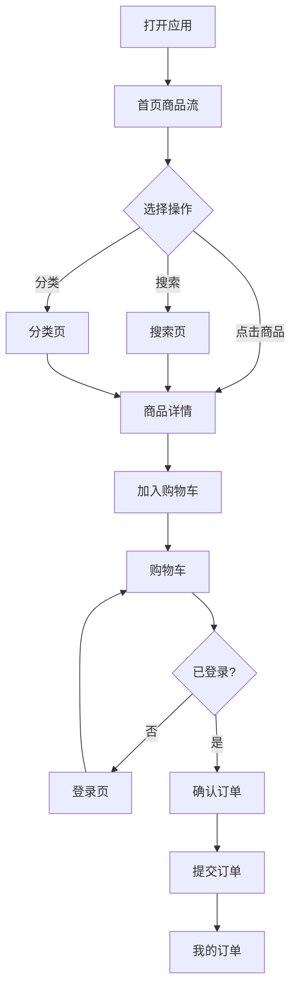

# 需求分析

## 1. 项目背景

《移动应用开发》课程要求使用 HarmonyOS NEXT + ArkTS 完成一个可在真机/模拟器运行的移动应用。本组选择“电子商城”方向，在课程商品列表要求的基础上扩展为完整的“浏览 → 购物 → 登录”闭环，并加入收藏、优惠券等自选功能。

## 2. 目标用户与场景

| 用户 | 典型场景 | 核心诉求 |
| --- | --- | --- |
| 数码爱好者 | 浏览新品、对比价格 | 快速找到商品，信息清晰 |
| 学生用户 | 购买耳机、手环等配件 | 操作简单，价格与优惠明确 |
| 家庭用户 | 选购智能家居设备 | 分类清楚，下单流程短 |
| 课程评审 | 按评分点验收 | 功能可演示、代码结构清晰、文档完整 |

## 3. 功能需求

| 编号 | 模块 | 功能 | 优先级 | 负责人 |
| --- | --- | --- | --- | --- |
| F01 | 浏览 | 首页商品列表，展示图片、名称、价格、销量 | P0 | A |
| F02 | 浏览 | 列表上下滑动流畅，使用 List + LazyForEach | P0 | A |
| F03 | 浏览 | 下拉刷新、上拉加载更多、到底提示 | P0 | A |
| F04 | 浏览 | 多品类切换：精选/手机/电脑/穿戴/家居/配件 | P0 | A |
| F05 | 浏览 | 分类页：左侧分类、右侧商品联动 | P1 | B |
| F06 | 浏览 | 搜索：按名称/标签匹配，空结果提示 | P1 | B |
| F07 | 浏览 | 商品详情：图片、价格、标签、介绍、加入购物车 | P0 | B |
| F08 | 购物 | 购物车：增删、数量加减、单选/全选、合计 | P0 | C |
| F09 | 购物 | 结算：确认商品、地址、金额并提交订单 | P0 | C |
| F10 | 购物 | 订单列表：订单号、商品、金额、状态、时间 | P0 | C |
| F11 | 购物 | 收货地址：新增/修改并在结算页回显 | P1 | C |
| F12 | 登录 | 账号密码登录、退出、登录态保持 | P0 | D |
| F13 | 用户 | 个人中心：订单、收藏、地址入口 | P0 | D |
| F14 | 自选 | 收藏：详情页收藏/取消，收藏列表 | P1 | B |
| F15 | 自选 | 优惠券入口、深色模式（选做） | P2 | D |

## 4. 非功能需求

- **性能**：首页首屏 2 秒内出现内容；列表滑动无明显卡顿；图片懒加载。
- **兼容**：手机为主，兼容平板；HarmonyOS NEXT API 12。
- **可用性**：主要操作 3 步内完成；空状态、加载中、失败均有提示。
- **可维护性**：页面、服务、模型分层；共享常量集中管理；关键代码有注释。
- **安全**：不提交签名文件、密钥、真实用户数据；登录为课程 Mock 实现。

## 5. 核心流程

## 6. 验收标准

1. 首页六个品类均可切换，商品数据正确，滑动流畅。
2. 下拉刷新有动画并恢复列表；上拉到底显示“加载中/已经到底了”。
3. 搜索“耳机”“手表”等关键词能命中；无结果有提示。
4. 详情页可加入购物车，购物车角标同步变化。
5. 购物车数量、选中状态、合计金额计算正确。
6. 未登录结算会跳转登录；登录后可提交订单并生成订单记录。
7. 收藏、地址在重启应用后仍保留（PersistentStorage）。
8. 真机/模拟器无崩溃、无空白页，核心流程可完整演示。
