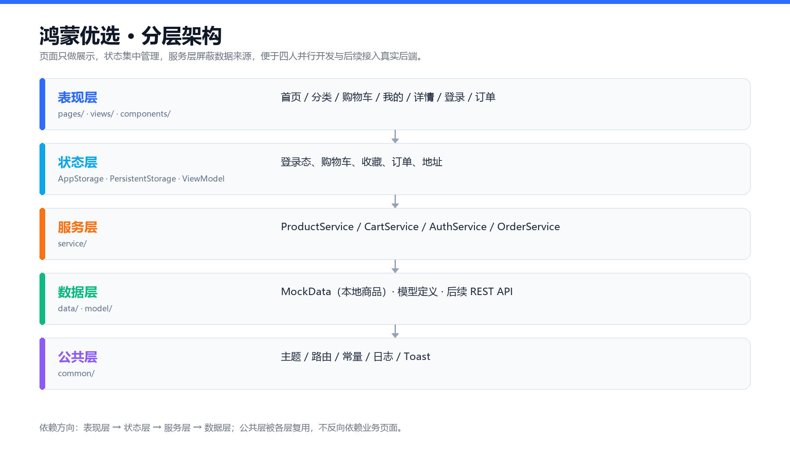
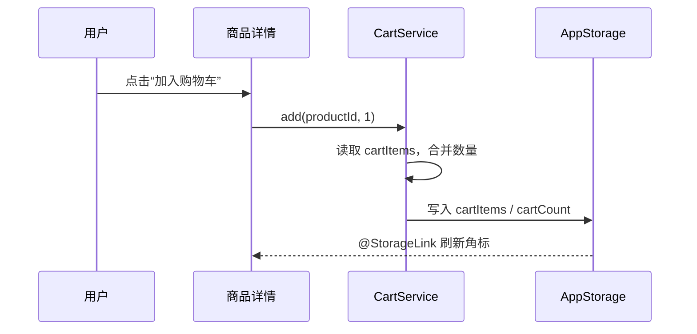
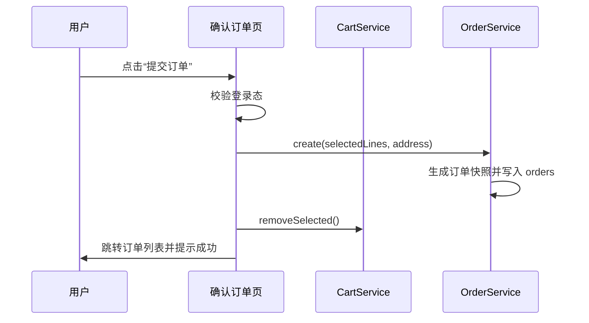

# 概要设计

## 1. 分层架构

| 层 | 目录 | 职责 | 负责人 |
| --- | --- | --- | --- |
| 表现层 | `pages/`、`views/`、`components/` | 页面布局、交互、组件复用 | A/B/C/D |
| 状态层 | `AppStorage`、`PersistentStorage`、`viewmodel/` | 登录态、购物车、收藏、订单 | A/C/D |
| 服务层 | `service/` | 商品、购物车、订单、登录、收藏 | A/C/D |
| 数据层 | `data/`、`model/` | Mock 数据、类型定义、后续 REST | A |
| 公共层 | `common/` | 主题、路由、常量、日志、Toast | A/D |

依赖方向：表现层 → 状态层 → 服务层 → 数据层；公共层被各层复用，不反向依赖业务页面。

## 2. 页面与路由

| 页面 | 路由 | 说明 | 负责人 |
| --- | --- | --- | --- |
| 首页 | `pages/Index` | 底部四个 Tab 的容器 | A |
| 商品详情 | `pages/ProductDetailPage` | 商品信息、收藏、加购、立即购买 | B |
| 搜索 | `pages/SearchPage` | 关键词搜索、热门搜索 | B |
| 登录 | `pages/LoginPage` | 账号密码登录、退出 | D |
| 确认订单 | `pages/OrderConfirmPage` | 地址、商品清单、提交订单 | C |
| 我的订单 | `pages/OrderListPage` | 订单列表与状态 | C |
| 我的收藏 | `pages/FavoritesPage` | 收藏商品列表 | B |
| 收货地址 | `pages/AddressPage` | 地址编辑与保存 | C |

路由常量统一放在 `common/constants/RouteConstants.ets`，页面跳转统一走 `RouterUtil`。

## 3. 主界面结构

`Index.ets` 使用 `Tabs`（底部）承载四个视图：

| Tab | 视图 | 主要内容 |
| --- | --- | --- |
| 首页 | `HomeView` | 品牌头部、搜索入口、轮播、快捷入口、六品类商品流 |
| 分类 | `CategoryView` | 左侧品类、右侧商品列表 |
| 购物车 | `CartView` | 商品行、选择、数量、合计、结算 |
| 我的 | `ProfileView` | 登录入口、订单状态、收藏/地址/优惠券菜单 |

## 4. 状态与持久化

| Key | 类型 | 说明 | 初始化位置 |
| --- | --- | --- | --- |
| `token` | string | 登录令牌，空表示未登录 | `EntryAbility` |
| `userName` | string | 显示昵称 | `EntryAbility` |
| `cartItems` | string(JSON) | `CartItem[]` 序列化 | `EntryAbility` |
| `cartCount` | number | 购物车角标数量 | `EntryAbility` / `CartService` |
| `favoriteIds` | string(JSON) | 收藏商品 id 数组 | `EntryAbility` |
| `orders` | string(JSON) | `Order[]` 序列化 | `EntryAbility` |
| `address` | string | 收货地址 | `EntryAbility` |

写操作统一由 `service` 层修改 `AppStorage`，页面通过 `@StorageLink` 自动刷新。

## 5. 关键流程

### 5.1 加入购物车

### 5.2 提交订单

## 6. 目录与命名约定

- 页面文件：`XxxPage.ets`；视图组件：`XxxView.ets`；通用组件：`XxxCard.ets`。
- 服务类：`XxxService.ets`，只暴露静态方法，不持有页面状态。
- 模型：接口用 `interface`，路由参数用 `class`（便于 ArkTS 类型检查）。
- 资源：`ic_` 前缀表示图标，`product_` 表示商品图，`banner_` 表示轮播图。
- 颜色、字号、圆角统一从 `common/theme/AppTheme.ets` 引用。
