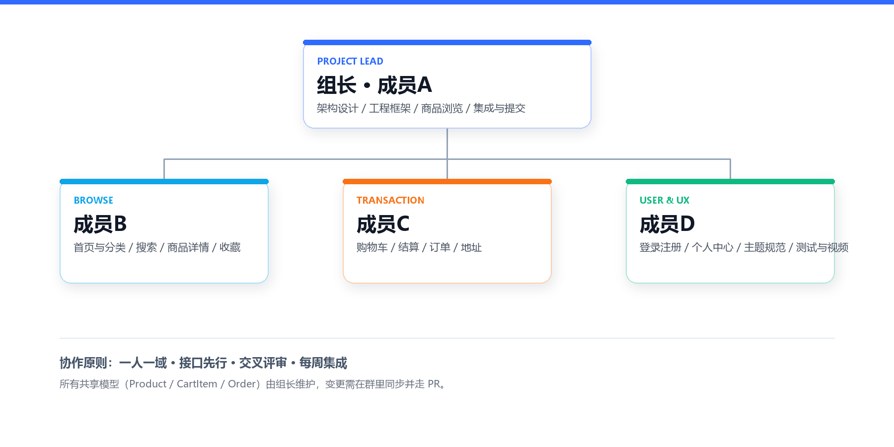

# 项目文档

| 文档 | 内容 | 维护人 |
| --- | --- | --- |
| [四人分工方案](四人分工方案.docx) | 成员分工、功能责任、进度、提交要求 | A |
| [01-需求分析](01-需求分析.md) | 背景、用户、功能与非功能需求、流程 | A/B |
| [02-概要设计](02-概要设计.md) | 分层架构、页面路由、状态与持久化 | A |
| [03-接口与数据模型](03-接口与数据模型.md) | 数据模型、服务接口、后续 REST 映射 | A/C |
| [04-开发规范](04-开发规范.md) | 分支、提交、ArkTS 约定、PR 流程 | A |
| [05-测试与验收](05-测试与验收.md) | 测试用例、兼容性、缺陷分级 | D |
| [06-提交清单](06-提交清单.md) | 打包命名、视频脚本、提交检查 | A/D |
| [07-课程评分点对照](07-课程评分点对照.md) | 课程评分点与代码/文档对应 | A |

## 文档约定

- 所有文档使用 Markdown（分工方案除外，提交 DOCX）。
- 流程图使用 Mermaid，GitHub 可直接渲染。
- 文档修改走 `docs/xxx` 分支，PR 到 `develop`。
- 涉及姓名、日期、版本号的变更，由组长统一更新。
